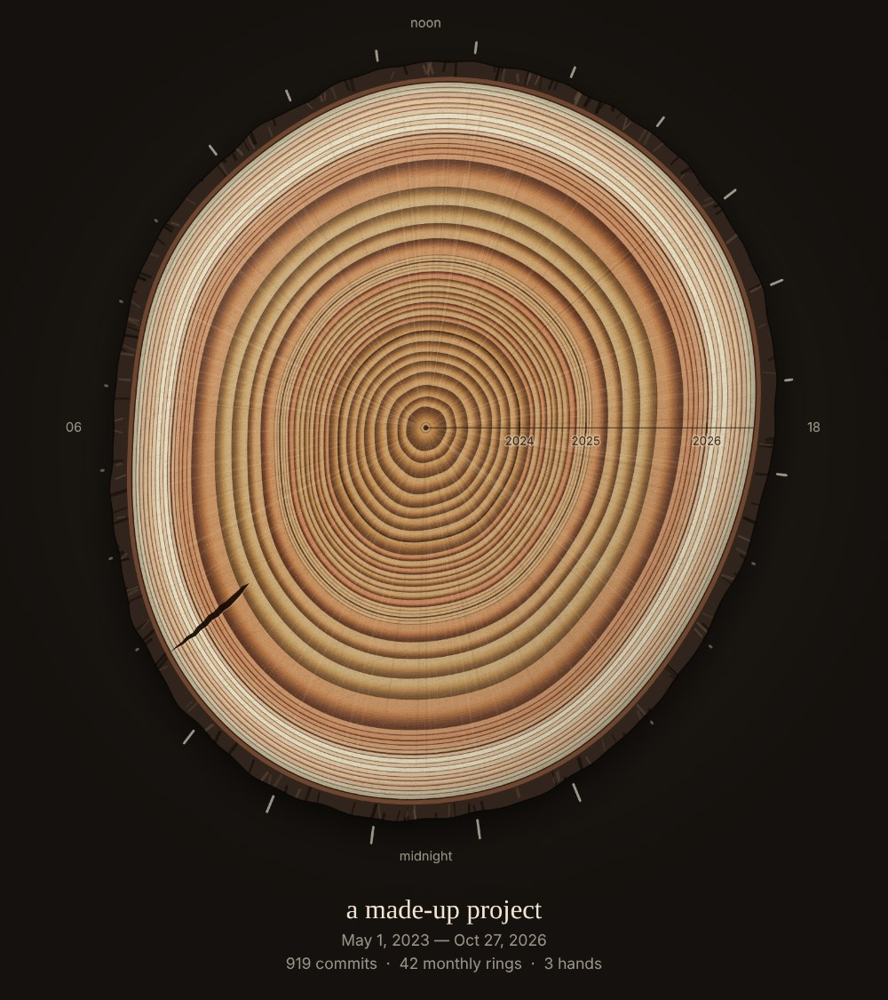

# Heartwood

Draws software activity as the growth rings of a cross-cut trunk.

**Try it: <https://masachika-kamada.github.io/heartwood/>** — nothing to
install, no account. Add `#owner/repository` or `#username` to the address to
open straight onto a tree, e.g.
<https://masachika-kamada.github.io/heartwood/#masachika-kamada/heartwood>.

<p align="center">
  
</p>

The picture is the product, not a reconstructed commit database. Each source
provides the smallest honest measurements it has — commit counts, dates,
authors or repositories, and changed lines only when they are actually known.
Missing measurements are omitted rather than replaced with invented values.

## Three ways in

- **A folder on this computer** — reads `.git` in the browser. Nothing leaves the
  machine.
- **`owner/repository`** — one repository, whole. GitHub has already counted
  every week of it, so the trunk arrives in three requests however old the
  project is.
- **A username** — a person's work across all their repositories. Without a
  token this is a sample of public commits; with one it is GitHub's own
  contribution calendar, every year of it.

Every tree has an address: `…/#owner/repository` or `…/#username` draws the same
trunk again, so a link can be shared.

## How to read it

| In the drawing | In the history |
| --- | --- |
| One ring | One day, week, month, quarter or year — chosen from the age of the history |
| Ring width | Activity volume: changed lines when known, otherwise commits or contributions |
| Which way the trunk leans | The hours the work was done in (noon at the top, midnight at the bottom), or the weekdays when only dates are known (Wednesday at the top, the weekend at the bottom) |
| Dense, dark wood | The share of a ring done at night, or at weekends when only dates are known |
| Pale outer band | Sapwood: the last twelve months. A history nobody has touched for a year has none |
| A tight dark seam | A stretch when nothing was committed |
| A crack | One measured change far larger than everything around it |
| Timber colour | Whoever committed most in that ring — or, for a person, whichever repository took most of it |
| Pencil marks | Where each year begins |

### A young trunk is drawn closer up, not thinner

A ring is not always a month. A history of a few weeks gets a ring a day, one
of a year or two gets a ring a week, and only decades are counted by the
quarter or the year, so every trunk has somewhere between a dozen and about a
hundred and forty rings. Ring widths are measured against the history's own
busy periods rather than anybody else's. A one-year-old project and a
fifteen-year-old one both fill the frame; the caption says what a ring is.

### The lean

The trunk is wrapped around a dial. Each ring grows thickest toward the part
of the dial its work was done in, and because the dial never moves, a habit
kept for years adds up: the pith ends up off-centre and the trunk heavy on one
side. Heavy underneath means built after hours. A change of habit shows as the
thick side moving from one era of rings to the next.

Only low, smooth curves are allowed to shape a ring, and a handful of commits
barely leans at all, so the result is an uneven trunk rather than a chart bent
into a circle. A small amount of waviness is grain, seeded by the name so the
same history always draws the same piece of wood; it is texture, not data, and
is always smaller than the lean.

The legend under the drawing is written for the tree on screen: it explains
only the marks that tree actually has.

## Privacy

The local option reads `.git` **in the browser** using the File System Access
API. No file, name, or commit message leaves the machine — there is no server to
send it to. That is the point: work that lives on an internal host, or on a
laptop only, still counts.

The GitHub options call `api.github.com` directly from the browser and nothing
else.

## What each GitHub source can and cannot say

**A repository** is read from GitHub's contributor statistics (commits and
changed lines per author per week, for the whole history) and its punch card
(the hours commits were made at, on the authors' own clocks). That is three
requests for any repository, instead of one per hundred commits. The price is
resolution: rings are never finer than a week, the lean is the same for every
ring, and GitHub reports only its top hundred contributors and stops counting
lines past ten thousand commits — the tree is marked partial, or drawn by
commit count, when that applies. A repository too young to have weeks, or one
GitHub has not finished counting, is read from its commit list instead, up to
the newest 1000 commits, with pages fetched in parallel.

**A person without a token** costs eight searches: the oldest hundred public
commits, the newest hundred, and six windows between them. Each search also
reports how many commits its window really holds, so the stretch a window's
hundred did not reach is not drawn as a silence: its known count is spread
evenly across it. The caption then says "about", and the status line says the
history is sampled.

**A person with a token** is read from the contribution calendar: one number
per day, complete for every year. Which repository each day's commits went to
is asked for alongside and may be partial, because it only decides colour. The
years are requested together rather than one after another. Contributions
follow GitHub's own counting rules, which include pull requests, reviews and
issues as well as commits.

Histories read from GitHub are remembered in this browser for six hours, so a
reload or a shared link costs no requests. "Read it again from GitHub" skips
that.

## The optional token

The page accepts a token, folded away under the GitHub field:

| | Search | Everything else |
| --- | --- | --- |
| Anonymous | 10 / minute, shared by everyone on your address | 60 / hour |
| With a token | 30 / minute | 5,000 / hour |

It is optional and always will be — a tool that argues it needs no account
cannot then demand one. A token turns a person's sampled trunk into their full
contribution calendar and draws repositories *you* can see rather than only
the ones the world can. A
public-only token access is enough for public history; grant repository read
access only to count private work. The token is kept in this browser's local
storage and sent to `api.github.com` and nowhere else, because there is no
server here.

## On a profile or project README

A README cannot run a page. GitHub strips every script and stylesheet out of
it, so the trunk there can only be an image. Heartwood can be run as a GitHub
Action that draws it on a schedule and commits it to your repository. There is
still no server: the drawing happens in your own workflow.

In the repository whose README should show it — for a profile, the one named
after your username — add `.github/workflows/heartwood.yml`:

```yaml
name: Heartwood
on:
  schedule:
    - cron: "17 3 * * 1" # once a week
  workflow_dispatch:

permissions:
  contents: write

jobs:
  grow:
    runs-on: ubuntu-latest
    steps:
      - uses: actions/checkout@v4
      - uses: masachika-kamada/heartwood@main
        # with:
        #   target: owner/repository   # default: the owner of this repository
      - name: Commit the drawing
        run: |
          git config user.name "github-actions[bot]"
          git config user.email "41898282+github-actions[bot]@users.noreply.github.com"
          git add heartwood README.md
          git diff --cached --quiet || git commit -m "Grow the trunk"
          git push
```

Then put two comments in the README where the trunk should go. The Action
fills in, and keeps up to date, whatever lies between them:

```html
<!-- heartwood:start -->
<!-- heartwood:end -->
```

### A README you can point at

What the Action writes between those comments is not only a picture. Two
things in it get a little interaction through GitHub's sanitiser, with no
script anywhere:

- **Under the trunk is its core sample** — the thin cylinder a forester bores
  out of a tree to count its rings, pith at the left and bark at the right.
  It is not one image but one image per ring, set side by side with nothing
  between them, and each carries a `title`. GitHub keeps titles, and a browser
  shows one when the pointer rests on its image. So resting on a band says
  what that ring is: *Mar 2023 · 48 contributions · 25% at weekends*.
  Clicking a band opens the page with that ring picked out.
- **The trunk itself knows where it was clicked.** Its image is marked
  `ismap`, an attribute from the 1990s that GitHub also lets through. A
  browser that follows a link around such an image adds the position of the
  click to the address — `…/#you@600?213,188`. The page lays the same picture
  out again, finds the ring under that point and opens with it picked out.

The titles hold dates and counts only, never the names of repositories or
people. To show only the picture, leave the comments out and write the image
yourself:

```html
<a href="https://masachika-kamada.github.io/heartwood/#YOUR-NAME">
  <picture>
    <source media="(prefers-color-scheme: dark)" srcset="heartwood/heartwood-dark.webp">
    
  </picture>
</a>
```

Run the workflow once by hand from the Actions tab to get the first drawing.
The workflow's own token reads public activity; to count private work, pass a
personal token as `token:` from a repository secret.

The same thing from a checkout, for any other use:

```sh
npm run build
npm run render -- owner/repository out/      # or a username
```

## Running it

```sh
npm install
npm run dev
```

```sh
npm test        # unit tests for the ring model and the git object parser
npm run build   # typecheck, then bundle to dist/
```

## Deploying

The output is a static folder with no backend, so anything that serves files
will do.

- **GitHub Pages** — `.github/workflows/deploy.yml` is included. Enable Pages
  with "GitHub Actions" as the source and push to `main`. The workflow sets
  `BASE_PATH` so the project subpath resolves.
- **Cloudflare Pages / Netlify / Vercel** — build command `npm run build`,
  output directory `dist`, no environment variables needed.

Browser support: opening a local folder needs the File System Access API
(Chrome, Edge, and other Chromium browsers). Everywhere else the page falls back
to the GitHub field and says so.

## Layout

```
src/core/      activity contracts, the ring model, deterministic randomness
src/sources/   where history comes from: local .git, a GitHub repository,
               a GitHub person, and a demo; plus the shared GitHub HTTP
               layer that handles rate limiting and the optional token,
               and the cache of recently read histories
src/render/    canvas drawing and PNG export
src/ui/        the hover inspector and the per-tree reading guide
scripts/       renders a history to image files by driving the built page
action.yml     the same, as a GitHub Action
```

Sources produce an `ActivityHistory`; renderers consume a `TreeModel`. API
response details do not cross that line.
